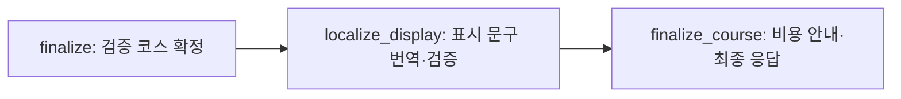

# 코스 이동 정보: `unknown` 응답

## API-AI-2 계약 추가

사용자 승인에 따라 `transportToNext.type`에 `unknown`을 추가한다. 요청 필드, SSE 이벤트 이름과 진행 step은 유지한다.

```json
{
  "type": "unknown",
  "distance": null,
  "minutes": null,
  "memo": null
}
```

- `unknown`: 다음 장소는 있지만 경로 정보를 확보하지 못한 상태. 거리·시간·내부 이동 요금은 null이며 임의 추정값이나 무료 요금을 넣지 않는다.
- `none`: 하루 마지막 장소처럼 다음 이동이 없는 상태. 기존 `distance: 0`, `minutes: 0`, `memo: null` 유지.
- 그 외 이동 수단: 실제 조회한 거리·시간을 유지한다. 실제로 90분을 넘는 구간은 기존 장소 재배치·복구 대상이며 unknown으로 숨기지 않는다.

## 생성·검증 정책

1. 기존 선호 수단으로 실제 경로를 조회한다. 실패한 경우 도보/대중교통 대안에 이어 택시 경로까지 확인한 후 unknown을 사용한다. 대중교통의 도보 대안은 기존처럼 직선거리 3km 이내에서만 조회한다. 택시는 실제 DRIVE 응답의 거리·시간을 사용하며 차량 소유나 택시 요금을 추정하지 않는다. 정상 경로가 있으면 대안 조회를 추가하지 않는다.
2. 현재 검증한 후보 조합 안에 이동 정보가 모두 확인된 대안이 있으면 우선한다. 미확인 구간이 남은 일차끼리는 기존 탐색 한도 안에서 일자 수와 장소 중복 방지를 지킨 다음 unknown 구간의 합계가 가장 적은 조합을 찾는다. 복구용 스냅샷도 방문 수 충족 다음으로 unknown 수가 적은 코스를 우선한다. 이 비교는 추가 장소 검색이나 LLM 호출을 하지 않는다.
3. 빈 경로, 불완전한 수치, 일시 오류, 시간 초과, Routes 전용 권한 오류 등으로 모든 허용 대안을 확인하지 못하면 장소를 유지하고 해당 구간을 unknown으로 반환한다. Routes 권한 오류는 전체 요청을, 공급자 재시도까지 소진한 일시 장애는 해당 이동수단의 반복 조회를 막는다. 다른 이동수단이나 이미 확인한 캐시 경로는 계속 활용한다.
4. unknown을 실제 성공 경로 캐시에 저장하지 않는다. 사용자 취소는 계속 전파한다. 장소의 실존·국가·좌표·유형 검증은 유지하며 장소 조회 오류를 unknown으로 바꾸지 않는다.
5. 이동 정보 부족 때문에 LLM 재생성·장소 축소를 반복하지 않는다. 다른 날짜와 장소 중복, 방문·식사 창, 알려진 장거리 이동 등의 기존 제약은 유지한다.

unknown 이후의 내부 시각은 방문 순서를 정하기 위한 잠정 하한이다. 이동 시간 0분을 측정했다는 뜻이 아니며 내부 도착 시각은 API에 노출하지 않는다. 이러한 시각을 이후 대중교통 조회의 확정 출발 시각으로 전달하지 않는다. 전체 이동 가능성이 검증된 코스라는 보장은 하지 않는다.

`totalCost`에는 확보한 장소 비용·이동 요금·항공·숙박 비용만 합산한다. unknown 구간의 이동 요금은 미포함이며 무료로 확정한 것이 아니다.

## 장소 오류와 선택 견적 복구

- 개별 Places 상세의 404·410·잘못된 JSON·ID 불일치는 그 ID만 제외하고 다음 결과나 기존 영어 검색 대안을 확인한다. 정상 후보로 기존 방문 수·식사·일자 중복 기준을 계속 검증한다. 인증·잘못된 요청 오류를 숨기지 않는다.
- 목적지 검색은 삭제된 ID만 제외한다. 다른 상세 응답이 일시 장애나 불완전한 데이터이면 모호한 목적지를 임의로 확정하지 않는다.
- 공항 CSV·별도 카탈로그를 사용하지 않는다. MyRealTrip이 실제 도시·국가와 일치한다고 반환한 공항만 사용하고, 미확보이면 항공 견적만 unavailable로 처리한다.
- 목적지 Essentials 주소 구성요소의 실제 국가명(한국어)·도시명(영어)을 견적에 재사용한다. 국가와 도시가 같은 입력이면 한국어 상세를 공유한다. 필드 마스크·기본 Google 조회 수·공개 응답 구조는 유지한다.
- 숙박 상세의 지역명이 다를 때만 공식 MyRealTrip 지역 자동완성을 요청 내 최대 1회 조회한다. 정확한 국가·도시명과 유일한 CITY ID로 확인된 공급자 이름만 연결한다. 해당 ID를 MCP 도구 인자로 추정하여 전달하지 않는다. 날짜·인원·숙소 ID·원화 전체 숙박 가격·판매 상태 검증도 유지한다.
- 국가별 별칭 목록·외부 데이터 스냅샷·추정 가격을 추가하지 않는다. 명칭 연결에 실패해도 코스는 유지하며 해당 견적은 미확보로 남긴다.

## BE·FE 연결

- 저장·전달 DTO와 앱 enum에 `unknown`을 허용한다.
- unknown이면 거리·시간·이동 수단 아이콘을 임의의 값이나 도보로 표시하지 않는다. 필요하면 두 장소의 Google Maps 길찾기로 연결한다.
- 마지막 장소의 none과 경로 미확보 unknown을 구분한다.
- 이 AI 저장소에는 실제 BE·FE DTO와 표시 구현이 포함되지 않는다. 명세 서브모듈은 읽기 전용이므로 변경하지 않았다.

## 이동 메모의 언어 처리

Google Routes의 `languageCode`를 요청 언어로 지정해도 정류장·행선지·도보 안내에 현지어가 남을 수 있다. 원본 이동 안내를 요청 안에서 보존하고, 확정된 코스의 장소 표시 이름과 메모를 선택적 LLM 후처리로 번역한다. 공개 API 구조는 유지한다.

1. 같은 Routes 응답에서 승차·하차 지점, 노선, 행선지와 도보 안내를 보존한다. 기존처럼 최대 세 개의 주요 행동을 선택하며 모든 환승 연결을 포함한다. 불완전한 공급자 데이터로 새로운 안내를 만들지 않는다.
2. 최종 코스의 중복된 장소명·문장을 제거한 뒤 요청의 `language`로 한 번에 번역한다. `place.placeName`도 번역 대상이며, 추천 이유·방문 팁·이동 메모에 반복된 장소명은 같은 표기로 맞춘다. 비한국어 요청에서는 같은 라틴 문자로 작성된 이름과 메모도 번역한다. 정류장·거리명은 읽을 수 있는 표기로 옮기고 안내 문장은 자연스럽게 다듬는다. 장소 설명·방문 팁의 기존 현지화 호출이 있으면 같은 호출에 합친다. 한국어도 외국어 장소명·경로·방문 팁·추천 이유·제목·태그 중 번역 대상이 있으면 같은 호출에 모은다. 이미 한국어인 구조화 경로는 원래 행동과 순서를 로컬에서 보존하고 번역 호출에서 제외한다. 알려진 장소명만 치환하면 되는 추천 이유·방문 팁은 중복 번역하지 않는다.
3. 노선 코드와 숫자·주소 번호·거리 단위는 보호 토큰으로 바꾸고 서버에서 복원한다. 서버가 검증된 승하차 역할·환승 순서를 담은 원본 메모를 구성한다. 이 메모 전체를 하나의 번역 단위로 보내며 각 조각을 따로 번역해 다시 섞지 않는다. 최종 문장에도 승하차·환승 순서를 유지하도록 지시한다. 거리·시간·요금·이동 수단과 장소 ID는 번역 모델이 수정할 수 없다.
4. 누락·중복된 문장 ID, 보호 토큰 변조, 새 숫자·링크·잘못된 문자 체계의 번역은 해당 이동 구간에서 채택하지 않는다. 원본에 없는 출구·지름길·시설·방향을 추가하지 않도록 지시한다. 이러한 구조 검사는 번역의 의미적 정확성을 완전히 보증하지 않으며 같은 문자를 쓰는 언어 사이를 판별하지 않는다.
5. 누락되거나 검증에 실패한 이동 구간의 메모 전체만 한 번 보완 번역한다. 이미 받아들인 장소명·문장은 다시 요청하거나 폐기하지 않는다. 시간 초과·모델 오류·잘못된 출력이면 아직 번역하지 못한 구간의 원본 안내만 유지하고 코스를 완료한다. 일부 구간의 번역 실패가 다른 구간의 정상 번역을 제거하지 않는다. 원본 정류장명이 남을 수 있지만 일반적인 지도 앱 안내로 정보를 지우지 않는다. 구조화된 원본이 없는 구간도 기존 메모 전체를 번역한다. 번역이 불가능하면 기존 메모와 장소명을 유지한다. 안내 자체가 없는 구간에는 기존 안전 문구를 사용한다.
6. 도보·대중교통·환승을 포함한 이동 구간의 메모 전체를 한 문단으로 번역하고 자연스럽게 연결한다. 연속된 좌회전 같은 행동은 서로 다른 회전일 수 있으므로 횟수와 순서를 유지한다. 약 240자를 목표로 하되, 이 길이를 넘는다는 이유로 정상 번역을 원문으로 되돌리지 않는다. 이름이나 필요한 안내도 자르지 않는다. unknown·none의 메모는 null이다. 사용자에 의한 취소는 계속 전파한다.

예시 문장(모의 번역 응답):

> 호앙지에우 131번지 정류장에서 07번(쑤언지에우 - DN-HC0039 방면)을 타고 18~20번지 맞은편 정류장에서 내리세요.

최초 번역과 최대 한 번의 보완이 동일한 최대 60초의 한도를 공유하며, 전체 코스 요청의 남은 시간을 넘기지 않는다. 긴 일정의 메모 전체가 기존 15초 제한으로 원문 복구되는 일을 줄이기 위해, 마지막 현지화 단계는 25초짜리 다른 선택 작업 예산도 재사용하지 않는다. 각 SDK 호출의 자동 재시도는 사용하지 않는다. 정상 번역이면 기존 한 번의 호출을 유지하며, 검증 실패·누락 때만 추가 호출이 한 번 발생한다. 보완 실패가 정상 추천 이유·방문 팁을 기본 템플릿으로 되돌리게 하지 않는다. 본문이나 다른 슬롯의 형식 오류가 같은 응답의 정상 장소명·경로 번역을 폐기하지 않도록 항목별로 검증한다. 영어 요청에 일본어·중국어 문장이 남는 경우도 문자 체계 검사로 거부한다. 최종 방문 팁·추천 이유에 맞지 않는 문자가 남으면 기존 언어별 장소 유형 문구로 보완한다. 이 검사는 동일 문자 체계의 언어까지 구분하지는 못한다. 기존 `course.candidates.generate` 라우팅을 재사용하며 Google API 호출·필드·요금제는 추가하지 않는다. 번역할 원본·외국어 장소명·혼합 방문 팁이 없는 한국어 코스는 LLM 번역을 호출하지 않는다. 장소명 번역은 표시 텍스트만 바꾸며 Place ID와 좌표·분류는 유지한다. 내부 원본 안내는 공개 응답에 직렬화하지 않는다.

## 자동화 검증

외부 API·LLM 호출을 격리한 회귀 테스트로 검증한다. 실제 SDK가 직렬화하는 요청, Google Essentials 필드, 중복 조회 방지, 번역 실패 시 원문 보존, 장소 ID·좌표·경로 수치 유지와 SSE 완료를 확인한다.

```bash
bash .agents/hooks/test.sh
```

## 실제 LLM으로 확인한 원문 잔류 원인과 검증

2026-10-18 수동 실행에서 기존 번역 전용 `course.copy.localize`는 실제 Gateway가 HTTP 400 `missing outbound provider key`로 거부했다. 같은 서버 키·모델에서 기존 `course.candidates.generate` 컨텍스트로 바꾸자 HTTP 200과 정상 번역을 확인했다. 번역도 코스 생성의 후처리이므로 이 기존 Gemini 라우팅을 재사용한다. 환경변수 키나 SDK 초기화·직접 폴백 정책은 변경하지 않았다.

[수동 검증 스크립트](../scripts/verify_route_memo.py)는 사용자 보고 중국어·일본어 메모를 실제 현지화 서비스에 넣고 LLM 원본 응답·최종 메모·토큰 사용량·소요 시간을 출력한다. 진단용 장소 ID를 사용하며 Google Maps·항공·숙박은 호출하지 않는다. 자동화 테스트와 다르게 `--live`를 명시해야 실제 LLM 요청이 발생한다.

```bash
python scripts/verify_route_memo.py --live --case china
python scripts/verify_route_memo.py --live --case japan
```

수정 후 실제 실행 결과: 중국 사례 HTTP 200, 6.03초·입력 438/출력 131토큰; 일본 사례 HTTP 200, 6.49초·입력 438/출력 151토큰. 두 사례 모두 각 1회 LLM 호출로 장소명·메모가 한국어로 반환됐고, 진단용 ID·이동 수단·거리·시간은 유지됐다. 이는 해당 문장들에 대한 실제 모델 검증이며 전체 여행 코스의 실존 장소·경로를 새로 검증한 결과는 아니다.

### 베를린 일부 메모의 원문 복구 오류

도로 코드 뒤에 한국어 조사가 붙는 `B96에`에서는 Unicode 단어 경계 때문에 기존 정규식이 `96`만 보호했다. `B2/B5에`도 `B2/`와 `5`로 잘못 나뉘었다. 실제 모델이 이 입력의 `B`를 그대로 옮긴 정상 번역까지 한국어 문자 검사에서 거부하면서 해당 메모만 원문으로 돌아갔다. 식별자 경계를 ASCII 기준으로 바꾸고 구분자로 끝나는 불완전한 코드를 잡지 않도록 수정했다. 거리 단위도 `33m를`처럼 조사와 붙어 있을 때 함께 보호한다.

`17. Juni` 같은 도로명에서 월 단어를 숫자 날짜로 변환하면 원본에 없는 `6`이 추가되어 검증에 걸린다. 이를 숫자 추가 허용으로 우회하지 않고, 도로명은 고유명사로 음역해 숫자 사실을 보존하도록 명시했다. 보호된 코드의 발음을 모델이 알 수 없어 출력한 `B96(으)로` 등은 복원한 코드에 맞는 조사로 마무리한다.

문제의 길 안내 문장 4개만 사용한 수동 실제 LLM 진단에서 수정 전에는 최초 번역·보완 번역 모두 HTTP 200이었지만 4개가 모두 검증에서 거부됐다. 수정 후에는 7.38초·LLM 1회로 네 메모가 모두 채택됐고 거부는 0개였다. 실제 장소 ID·좌표·추천 이유를 외부로 보내지 않은 문장 단위 진단이다.


## 표시 언어 전용 LangGraph 노드 (2026-10-18)



모든 정상 생성·복구 경로가 완료 전에 `localize_display`를 거친다. 별도 번역 서버를 만들지 않고, 기존 ABTO 경유 LLM 호출과 `course_localization` 서비스를 이 노드에서 실행한다. 기존 `finalize_course`는 비용 안내와 최종 코스 반환을 담당한다. 공개 SSE 이벤트·step·응답 필드는 유지한다.

- 장소 ID·좌표·분류·방문 순서·경로 수치·비용은 번역 대상이 아니다. 화면의 장소명, 방문 팁, 추천 이유와 이동 안내만 다듬는다.
- 장소 후보 생성에서는 검색 가능한 요청 언어의 공식명·통용명을 우선하고, 모르는 이름을 임의 번역하지 않는다. 외국어 장소명을 썼다면 최종 표시 번역에 포함한다.
- 한 구간의 메모 전체를 자연스러운 문단으로 번역한다. 노선 코드·숫자, 연속 회전 횟수·환승 순서·접근 제한 등은 보존한다. 사실을 생략해서 짧게 만들지 않는다.
- 이미 한국어인 문구는 모델 요청에서 제외한다. 반복 문구는 중복 제거하고, 정상 장소명 번역을 추천 이유·메모에도 재사용한다. 지침 프롬프트의 반복도 줄였다.
- 기존 최초 1회와 실패 항목 보완 최대 1회의 호출 한도, 합계 최대 60초와 전체 요청의 남은 시간 한도를 유지한다. 노드 분리 때문에 호출을 추가하지 않으며 Google 조회·요금제도 늘리지 않는다.
- **사용자 선택에 따라 번역 장애·시간 초과·보완 실패 시 원문 이동 메모와 식별 가능한 장소명을 유지한다.** 따라서 외부 LLM 장애까지 포함한 번역 100% 성공을 보장하지 않는다. 지점 정보가 사라질 수 있는 괄호 속 외국어 일괄 삭제나 이름 임의 생성은 하지 않는다.

검증은 실제 SDK 직렬화와 네트워크를 격리한 회귀 테스트로 수행한다. 정상 번역 1회, 부분 누락 시 실패 메모만 보완, 503 시 원문을 유지한 코스 완료를 확인한다. 이 자동화 검사는 실제 외부 API의 번역 품질이나 운영 응답 시간을 측정하지 않는다.
